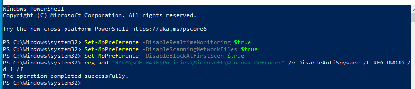

# SOC Home Lab Journey

Welcome! This repository is my personal learning journal as I build a **Security Operations Center (SOC) home lab**. I am documenting the setup, labs, and findings as I work through phishing analysis, network monitoring, endpoint defense, SIEM, threat intelligence, digital forensics, and incident response.

The goal is simple: practice like an analyst. Isolated virtual machines, real tools, and write-ups I can look back on.

---

## Lab topology

I am using **VMware Workstation** with two adapters per VM so the lab can talk internally and still reach the internet for tools and updates.

| Role | VM | NAT IP (VMnet8) | Host-Only IP (VMnet2) |
| --- | --- | --- | --- |
| Victim / analyst workstation | Windows 10 | `192.168.81.133` | `192.168.10.6` |
| Attacker / analysis host | Kali Linux | `192.168.81.138` | `192.168.10.5` |

| Network | Adapter | Subnet | Purpose |
| --- | --- | --- | --- |
| Host-Only | VMnet2 | `192.168.10.0/24` | Isolated traffic between lab VMs |
| NAT | VMnet8 | `192.168.81.0/24` | Internet access for downloads and updates |

Setup notes live in [`labs/00_Lab_Setup/`](labs/00_Lab_Setup/README.md).

---

## Progress tracker

| Module | Folder | Status |
| --- | --- | --- |
| 00 Lab Setup | [`labs/00_Lab_Setup/`](labs/00_Lab_Setup/README.md) | Done |
| 01 Phishing Analysis | [`labs/01_Phishing_Analysis/`](labs/01_Phishing_Analysis/README.md) | In Progress |
| 02 Network Security | — | Upcoming |
| 03 Endpoint Security | — | Upcoming |
| 04 SIEM | — | Upcoming |
| 05 Threat Intelligence | — | Upcoming |
| 06 Digital Forensics | — | Upcoming |
| 07 Incident Response | — | Upcoming |

---

## Disclaimer

This is an **isolated home lab** on virtual machines. Nothing here is meant for production systems, other people's mailboxes, or live networks I do not own.

Windows Defender was **disabled only on the lab Windows 10 VM** so I could practice analysis safely. I would never do this on a personal or work machine.

---

## Resources

- [TCM Security — Security Operations (SOC) 101 on YouTube](https://www.youtube.com/watch?v=56NDgBOSpUg)
- [Official free course GitHub repo (`MalwareCube/SOC101_Free`)](https://github.com/MalwareCube/SOC101_Free)
- [TCM Security Academy — SOC 101](https://tcm-sec.com/academy/security-operations-soc-101/)

---

Thanks for reading along. I am learning in public, one lab at a time.
