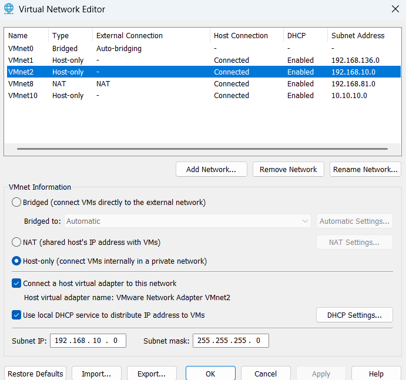
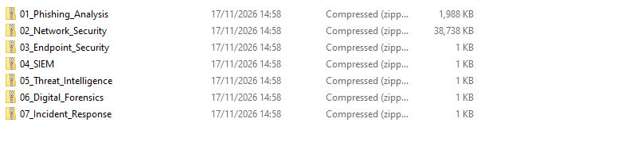

# SOC-Home-Lab-Journey
My journey building a SOC Home Lab to practice threat hunting and incident response.
# SOC Home Lab Journey 🛡️

Welcome to my Security Operations Center (SOC) Home Lab project! The goal of this lab is to practice threat hunting, network security, and incident response by simulating real-world attacks and defending against them.

## 🏗️ Lab Architecture & Setup

### 1. Virtual Environment & Networking
I am using **VMware Workstation** to host my virtual machines.
*   **VMnet2 (Host-Only):** `192.168.10.0/24` - Used for internal lab traffic between the attacker and victim machines.
*   **VMnet8 (NAT):** Used to provide internet access to the VMs for downloading tools and updates.

### 2. Virtual Machines
*   **Windows 10 (Victim/Target):** 
    *   NAT IP: `192.168.81.133`
    *   Host-Only IP: `192.168.10.6`
*   **Kali Linux (Attacker):**
    *   NAT IP (`ens33`): `192.168.81.138`
    *   Host-Only IP (`ens37`): `192.168.10.5`

 

### 3. Security Preparations
To ensure the lab environment works properly and doesn't block my testing tools, I disabled Windows Defender's real-time protection on the Windows VM using PowerShell:
*   `Set-MpPreference -DisableRealtimeMonitoring $true`
*   `Set-MpPreference -DisableScanningNetworkFiles $true`
*   `Set-MpPreference -DisableBlockAtFirstSeen $true`

## 📂 Lab Modules
I will be working through the following modules and documenting my findings:
1.  Phishing Analysis
2.  Network Security
3.  Endpoint Security
4.  SIEM (Security Information and Event Management)
5.  Threat Intelligence
6.  Digital Forensics
7.  Incident Response

## 🚀 Next Steps
*   Install and configure **Sysmon** on the Windows VM.
*   Set up **Splunk** to collect and analyze logs.
*   Start simulating attacks from Kali and detecting them.
