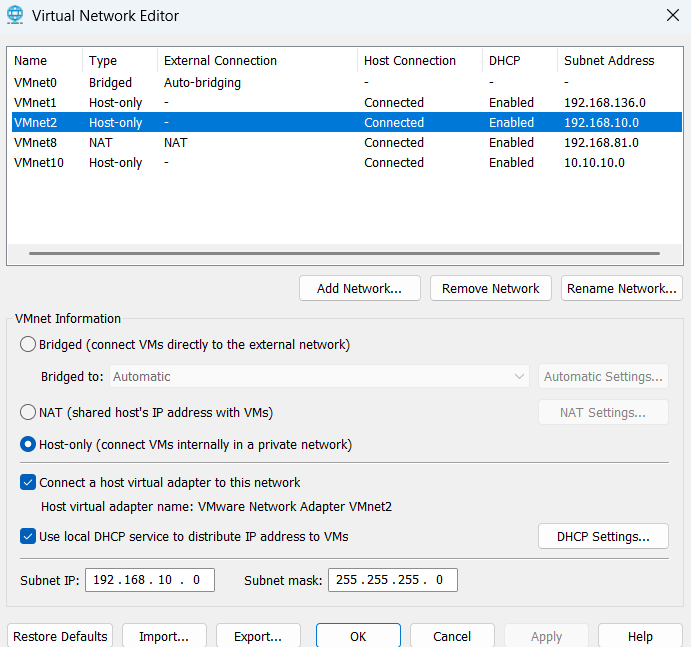
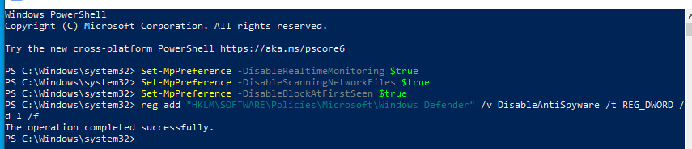

# 00 — Lab Setup

Status: **Done**

This module is the foundation of the SOC home lab: VMware networking, the two lab VMs, and the (lab-only) Windows security changes I made so later modules can run cleanly.

## What I set up

- **Hypervisor:** VMware Workstation
- **Windows 10** as the victim / analyst workstation
- **Kali Linux** as the attacker / extra analysis host
- Dual NICs so each VM is on both the isolated lab LAN and NAT

## Addresses

| VM | VMnet8 NAT | VMnet2 Host-Only |
| --- | --- | --- |
| Windows 10 | `192.168.81.133` | `192.168.10.6` |
| Kali Linux | `192.168.81.138` | `192.168.10.5` |

| Network | Subnet | Why it exists |
| --- | --- | --- |
| VMnet2 Host-Only | `192.168.10.0/24` | Internal lab traffic between attacker and victim |
| VMnet8 NAT | `192.168.81.0/24` | Internet for tools, updates, and lookups |



## Lab-only Defender settings

On the **isolated Windows 10 lab VM only**, I turned off some Defender protections so malware-analysis style exercises would not get blocked mid-lab:

```powershell
Set-MpPreference -DisableRealtimeMonitoring $true
Set-MpPreference -DisableScanningNetworkFiles $true
Set-MpPreference -DisableBlockAtFirstSeen $true
```

This is **not** something I would do on a real machine.



## Related notes

I also captured SOC fundamentals theory in [`notes/01-soc-fundamentals.md`](../../notes/01-soc-fundamentals.md) while watching TCM Security's SOC 101 course.

## Next

With the lab online, I moved into [phishing analysis](../01_Phishing_Analysis/README.md).
