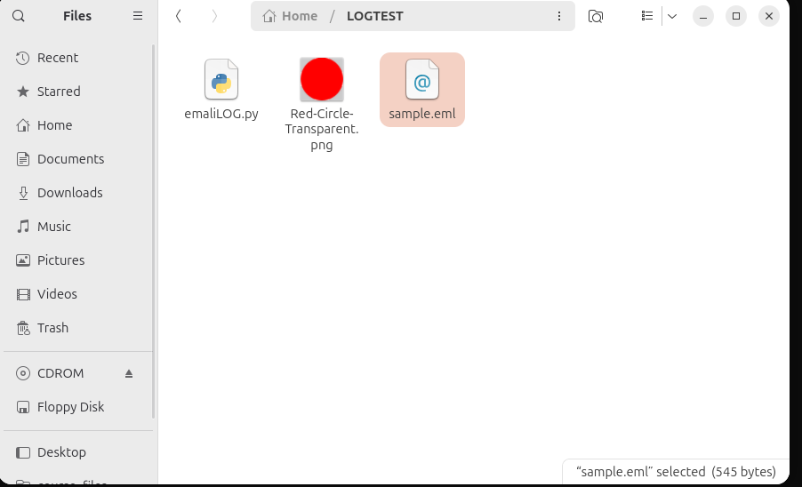
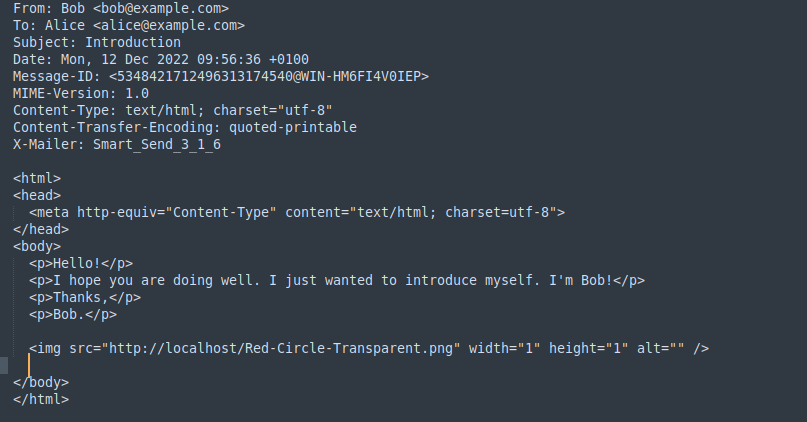
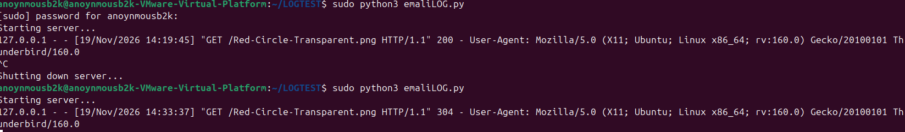
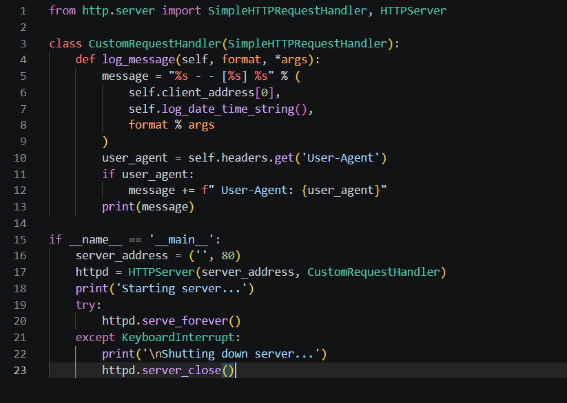

# 01 — Header & Sender Analysis

Status: **Done**

This is the first hands-on phishing lesson I documented. I opened a suspicious `.eml`, walked the headers like an analyst, and then built a tiny Python HTTP server so I could *see* what a tracking pixel actually logs when someone opens the message.

Everything below was done in my isolated SOC lab — not against a real mailbox.

---

## What I learned

### Reading email headers

Headers are the story of how a message got to the inbox. Before I trusted the pretty "From" name in the client, I checked:

- `From` vs `Reply-To` vs `Return-Path`
- `Received` hops (who really handled the mail)
- `Authentication-Results` for SPF, DKIM, and DMARC
- HTML in the body for hidden images and odd URLs

### SPF, DKIM, and DMARC

These three checks answer different questions:

| Check | Question it answers |
| --- | --- |
| **SPF** | Is this sending IP allowed to send mail for this domain? |
| **DKIM** | Is the message signed, and does the signature still match? |
| **DMARC** | Do SPF/DKIM align with the visible `From` domain, and what should the receiver do (`none` / `quarantine` / `reject`)? |

A single `pass` does **not** mean the email is safe. Attackers abuse domains with weak policy (`p=none`) and spoof the *display name* so the user sees "Chase" while the reply goes somewhere else.

### Tracking pixels

A tracking pixel is usually a **1×1 hidden image** in the HTML. When the email client loads remote images, it requests that URL. The server on the other end can log:

- Client **IP address**
- **Time** the message was opened
- **User-Agent** (often revealing the email client and OS)

That is why analysts care about hidden `` tags even when there is no obvious malware attachment.

---

## Header findings (this sample)

I analyzed [`sample.eml`](sample.eml) in this folder.

| Header | Value | Why it matters |
| --- | --- | --- |
| `From` | `Chase Alerts <alerts@chase.com>` | Looks like a bank alert |
| `Reply-To` | `kellyellin426@proton.me` | Replies would go to a Proton address, not Chase |
| SPF | `PASS` | The envelope sender's SPF check passed — still not "safe" |
| DKIM | `TIMEOUT` | Signature could not be verified in time |
| DMARC | `action=none` | Even if aligned, the domain policy does not quarantine or reject |

**Spoofed display name:** the UI says Chase, but `Reply-To` is `kellyellin426@proton.me`. That mismatch is a classic phishing tell. SPF passing does not fix a dishonest display name or a weak DMARC policy.





---

## The tracking pixel

The HTML body includes a hidden 1×1 image that points at my lab listener (Kali / local HTTP server). When the message is opened and images load, the client fetches that pixel and my script logs the hit.

Typical pattern:

```html

```

In the lab, opening the message produced a request like:

```text
Starting server...
127.0.0.1 - - [19/Nov/2026 14:19:45] "GET /Red-Circle-Transparent.png HTTP/1.1" 200 - User-Agent: Mozilla/5.0 (X11; Ubuntu; Linux x86_64; rv:160.0) Gecko/20100101 Thunderbird/160.0
```

That line is the whole point of the exercise: **open = phone-home**. IP, timestamp, and User-Agent (here, Thunderbird on Linux).



---

## My Python script

I wrote a small HTTP server with Python's `http.server`. It serves files and, on every request, prints:

- Client IP
- Timestamp
- User-Agent

File: [`emaliLOG.py`](emaliLOG.py)



```python
from http.server import SimpleHTTPRequestHandler, HTTPServer

class CustomRequestHandler(SimpleHTTPRequestHandler):
    def log_message(self, format, *args):
        message = "%s - - [%s] %s" % (
            self.client_address[0],
            self.log_date_time_string(),
            format % args
        )
        user_agent = self.headers.get('User-Agent')
        if user_agent:
            message += f" User-Agent: {user_agent}"
        print(message)

if __name__ == '__main__':
    server_address = ('', 80)
    httpd = HTTPServer(server_address, CustomRequestHandler)
    print('Starting server...')
    try:
        httpd.serve_forever()
    except KeyboardInterrupt:
        print('\nShutting down server...')
        httpd.server_close()
```

On Linux, port 80 usually needs root (`sudo python3 emaliLOG.py`). For everyday lab use I could also bind to a high port such as `8080`.

---

## Files in this lesson

| File | What it is |
| --- | --- |
| [`README.md`](README.md) | This write-up |
| [`emaliLOG.py`](emaliLOG.py) | Tracking-pixel logging server |
| [`sample.eml`](sample.eml) | Lab sample message with spoofed sender + pixel |

Screenshots live in [`images/`](../../../images/) at the repo root so every module can reuse them.

---

## Takeaway

Today I learned not to trust the name in the inbox. I will keep checking `From` / `Reply-To`, reading `Authentication-Results` in full, and hunting for tiny images that quietly report when a message is opened.

Next in this module: content, URLs, and attachments.
